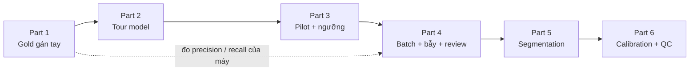

# Hướng dẫn làm lab (từng Part)

Bài **cá nhân**, khoảng **7–10 giờ thực tế** (máy yếu / lần đầu dùng CVAT: nhiều hơn) → chia **3 buổi**: Part 0–2 · Part 3–4 · Part 5–6. Các mục đánh dấu *(tuỳ chọn)* có thể bỏ nếu thiếu giờ; mục không đánh dấu là bắt buộc. Mốc tự kiểm tra ở [CHECKPOINTS.md](CHECKPOINTS.md).
Lệnh chạy **từ thư mục gốc repo**, venv đã kích hoạt. Mỗi Part có **sản phẩm** phải commit (commit theo từng Part).

```
Part 0  Cài đặt môi trường                      30-45'  docs/SETUP.md (tải model: chờ mạng)
Part 1  Đọc label contract + gán tay tập gold   45-60'  (KHÔNG dùng AI)
Part 2  Tour model: YOLO26 → SAM 2 → YOLOE → …  60-90'  docs/MODELS.md (D, E: tuỳ chọn)
Part 3  Pilot: duyệt + chọn ngưỡng theo lớp     45-60'
Part 4  Pre-label batch + ảnh bẫy + review      60-90'  docs/REVIEW_CHECKLIST.md
Part 5  Segmentation (SAM 2) + CVAT trực tiếp   45-60'  docs/CVAT_AI.md
Part 6  Calibration + QC + báo cáo              60-90'  docs/CALIBRATION_QC.md (Part 3: docs/THRESHOLD.md)
(Cộng nghỉ giữa các Part. Máy chỉ CPU: xem "Lộ trình máy yếu" bên dưới.)
```

Luật chơi: [RULES.md](RULES.md). Chấm điểm: [RUBRIC.md](RUBRIC.md). Cách nộp: [SUBMISSION.md](SUBMISSION.md).
Slide tham khảo: Day 08 (pre-label, checklist 4 bước, thiên kiến tự động hóa, đo tỉ lệ sửa), Day 07 (QC, Release / Hold / Rework).

## Lộ trình máy yếu (CPU only, ≤ 8 GB RAM) và Windows

- **Lựa chọn tốt nhất: Google Colab** (GPU T4 miễn phí) để chạy model, xem [docs/COLAB.md](docs/COLAB.md); CVAT và các script đo vẫn chạy trên máy bạn.
- Hoặc chạy local: làm **mọi lệnh** với `--size n`, `--imgsz 640` và `--sam mobile_sam.pt` (hoặc `sam2.1_t.pt`); tải `--set small` và `--set sam1`. **SAM vẫn bắt buộc** (chọn SAM 1 nhẹ). Bỏ Grounding DINO / OWLv2 / SAM 3 (mục D, E của MODELS.md): vẫn đủ điểm.
- Chạy model **từng tập** (không `--split all` một lần với model lớn) và để máy chạy trong lúc bạn duyệt; thời gian chạy CPU của model nhỏ trên 36 ảnh thường là vài phút, SAM 2.1 mất thêm vài giây mỗi vật (số này là **ước lượng**, hãy ghi số đo của bạn vào `model_log`).
- **Windows PowerShell:** (1) lệnh nhiều dòng trong tài liệu dùng `\` (bash): trên PowerShell hãy gộp thành **một dòng** hoặc thay `\` bằng dấu `` ` `` ở cuối dòng; (2) giá trị có dấu phẩy phải đặt trong **nháy kép**: `--split "batch,gold"`, `--classes "person,car"`, `--pos "400,480"`, `--thr "person=0.35,car=0.4"`; (3) `source .venv/bin/activate` → `.venv\Scripts\Activate.ps1`. Cách dễ nhất: dùng **Git Bash** hoặc **WSL** và chạy y nguyên lệnh trong tài liệu.
- File CSV (`model_log`, `time_log`, `calibration_decisions`, `qc_review`): sửa bằng trình soạn thảo văn bản, lưu **UTF-8** dấu phẩy. Excel hay lưu ANSI / dấu `;` làm script đọc sai.
- **Mac (Apple Silicon):** nếu gặp lỗi MPS, chạy với `PYTORCH_ENABLE_MPS_FALLBACK=1` hoặc `--device cpu`; CVAT Docker + model cùng lúc có thể thiếu RAM (16 GB là vừa).

## Bức tranh tổng



Ba tập ảnh (`data/split.csv`, 36 ảnh):

| Tập | Số ảnh | Vai trò | Quy tắc |
|---|---|---|---|
| **gold** | 6 | bạn **gán tay từ đầu**, làm chuẩn để đo máy và đo bạn | **không** xem pre-label trước khi gán xong |
| **pilot** | 6 | chọn model và ngưỡng | duyệt pre-label, dùng để quét ngưỡng |
| **batch** | 24 | lô thật: pre-label → duyệt → QC. 8 ảnh trong đó (`seg = 1`) làm segmentation | |

Một mẫu gốc, ba vai: **không bao giờ** dùng gold để chọn ngưỡng (tự chấm bài mình).

## Tóm tắt một trang

| Part | Việc | Lệnh chính | Sản phẩm |
|---|---|---|---|
| 0 | cài đặt | `pip install -r requirements.txt`, `check_env.py` | repo của bạn |
| 1 | gán tay 6 ảnh gold | `prepare_workdirs.py` + CVAT | `labels/gold_manual.json` |
| 2 | thử 5 loại model | `prelabel.py` | `model_log.csv`, nháp `recipe.md` |
| 3 | duyệt pilot, chọn ngưỡng | `merge_prelabels.py`, `threshold_sweep.py` | `labels/pilot_reviewed.json`, `qc/threshold_sweep.*` |
| 4 | pre-label + bẫy + review (24 ảnh) | `inject_traps.py`, `review_stats.py` | `prelabel/pre_traps…`, `labels/batch_reviewed.json`, `qc/review_stats.*` |
| 5 | mask | `prelabel.py --segmenter sam --sam <phiên bản>`, `coco_to_cvat_xml.py` | `labels/seg_reviewed.json` |
| 6 | calibration + QC | `threshold…` đã có, `self_consistency.py`, `qc_sample.py`, `qc_report.py`, `check_submission.py` | `guideline_v1.1_calibrated.md`, `QC_REPORT.md`, `REPORT.md` |

---

## Part 0 — Cài đặt (30–45 phút)

1. Tạo repo cá nhân từ repo đề: **Use this template / Fork** → đặt tên theo [SUBMISSION.md](SUBMISSION.md) (public) → `git clone`.
2. Làm theo [docs/SETUP.md](docs/SETUP.md): tạo venv, `pip install -r requirements.txt`, `python scripts/download_models.py --set core`.
3. `python scripts/check_env.py` → **SẴN SÀNG**.
4. Đặt thông tin git: `git config user.name "Họ tên"`, `git config user.email "<email gắn tài khoản GitHub>"`.
5. Mở CVAT (cvat.ai hoặc Docker), tạo **Project** theo [docs/CVAT_AI.md](docs/CVAT_AI.md) mục 1.
6. Điền [STUDENT.md](STUDENT.md) (thông tin), đổi dòng tiêu đề `README.md` (xem SUBMISSION.md). Commit.

**Sản phẩm:** repo chạy được `check_env.py`, `STUDENT.md`.

## Part 1 — Label contract và tập gold gán tay (45–60 phút)

**Mục tiêu:** có **chuẩn** của riêng bạn trước khi thấy máy. Nếu bạn gán gold sau khi đã thấy nhãn máy, bạn sẽ bị "neo" và không đo được thiên kiến.

1. Đọc [guideline/guideline_v1.0_label_contract.md](guideline/guideline_v1.0_label_contract.md) (10–15 phút). Chú ý mục 6 (câu hỏi còn mở).
2. `python scripts/prepare_workdirs.py` rồi tạo Task `gold-manual` từ `work/tasks/gold/` (6 ảnh).
3. **Gán tay**, theo guideline v1.0: **box** (Rectangle) cho mọi `person`, `bicycle`, `motorbike`, `car`, `bus`, `truck`, `three_wheeler`; `ignore_region` cho cụm quá nhỏ / dày. Không có AI.
4. Bấm giờ (ghi vào `submission/time_log.csv`, dòng `gold_manual`).
5. Gặp ca không chắc quy tắc → tick `can_review` và **ghi nhanh** vào `submission/individual_note.md` (mục ca khó). Đó là nguyên liệu cho calibration.
6. Export **COCO 1.0** (không lưu ảnh) → `submission/labels/gold_manual.json` → `python scripts/validate_labels.py --all`. Commit.

**Sản phẩm:** `labels/gold_manual.json`, dòng `gold_manual` trong `time_log.csv`.
> *Tự hỏi:* tôi đã dùng quy tắc nào của v1.0 mà thấy lúng túng? Có ca nào hai cách hiểu đều hợp lý không?

## Part 2 — Tour model (60–90 phút)

Làm theo [docs/MODELS.md](docs/MODELS.md), mục A → F. Mỗi lần chạy `prelabel.py` bạn ghi **một dòng** vào `submission/model_log.csv` (copy từ `work/runs.csv`, rồi điền `what_went_right`, `what_went_wrong`, `decision` **bằng mắt nhìn ảnh**).

Tối thiểu (kiểm tự động): **≥ 6 lần chạy, ≥ 3 model khác nhau** (gồm YOLO26, một model open-vocab, và **SAM: bắt buộc**; bạn chọn phiên bản SAM 1 / SAM 2.1 / SAM 3, xem [MODELS.md mục B0](docs/MODELS.md)). Khuyến khích: thử cả Grounding DINO / OWLv2; SAM 3 nếu có quyền.

Cuối Part 2:
1. Chạy `--split all --conf 0.05` cho YOLO26 và YOLOE (mục F của MODELS.md): hai file nguồn cho mọi Part sau.
2. Viết nháp `submission/recipe.md`: **lớp nào dùng model nào, vì sao**.

**Sản phẩm:** `model_log.csv`, nháp `recipe.md`.

## Part 3 — Pilot: duyệt và chọn ngưỡng theo lớp (45–60 phút)

1. Gộp pre-label của pilot ở ngưỡng thấp **0.10** (để GT pilot không bị cắt cụt ở 0.3; bù lại có nhiều box thừa phải xoá):
   ```bash
   python scripts/merge_prelabels.py work/prelabel/yoloe_all/pre.coco.json work/prelabel/y26_all/pre.coco.json \
       --conf 0.1 --iou 0.6 --split pilot --out work/prelabel/merged_pilot/pre.coco.json
   ```
2. Tạo Task `pilot` từ `work/tasks/pilot/`, nạp `merged_pilot/pre.coco.json` (**Upload annotations → COCO 1.0**, [CVAT_AI.md](docs/CVAT_AI.md) mục 3a).
3. **Duyệt** theo [checklist 4 bước](docs/REVIEW_CHECKLIST.md) (quét trước, nhìn nhãn máy sau). Đây là nhãn chuẩn của pilot. Bấm giờ (`pilot_review`).
4. Export `submission/labels/pilot_reviewed.json`; `validate_labels.py --all`.
5. Quét ngưỡng theo lớp:
   ```bash
   python scripts/threshold_sweep.py --pred work/prelabel/merged_pilot/pre.coco.json \
       --gold submission/labels/pilot_reviewed.json
   ```
   Đọc `qc/threshold_sweep.md` và hình `.png`. Lớp nào ít vật (n_gold nhỏ) thì ngưỡng yếu: nói rõ. Cách đọc: [docs/THRESHOLD.md](docs/THRESHOLD.md).
6. Chốt **recipe cuối** trong `submission/recipe.md`: model từng lớp, `--thr` từng lớp, `--iou` loại trùng, segmenter.

**Sản phẩm:** `labels/pilot_reviewed.json`, `qc/threshold_sweep.{csv,md,png}`, `recipe.md` (có ngưỡng và lý do).
> *Tự hỏi:* vì sao chọn ngưỡng **theo lớp**, không dùng một ngưỡng chung? Recall mục tiêu 90% có hợp lý cho `person`? cho `three_wheeler`?

## Part 4 — Pre-label batch, ảnh bẫy và review (60–90 phút)

1. Gộp pre-label cho **24 ảnh batch** và **6 ảnh gold** (gold vào file để đo **máy** so với gold; gold **không** đưa vào CVAT để duyệt):
   ```bash
   python scripts/merge_prelabels.py work/prelabel/yoloe_all/pre.coco.json work/prelabel/y26_all/pre.coco.json \
       --thr <chuỗi ngưỡng từ threshold_sweep> --conf 0.3 --iou 0.6 --split batch,gold \
       --out work/prelabel/merged_review/pre.coco.json
   ```
2. **Cài bẫy** (hạt giống = MSHV của bạn):
   ```bash
   python scripts/inject_traps.py --pre work/prelabel/merged_review/pre.coco.json --student <MSHV>
   ```
   Tạo `submission/prelabel/pre_traps.coco.json` (nạp vào CVAT) và `traps_key.json` (**đừng mở**).
3. Task `batch-review` từ `work/tasks/review/` (**24 ảnh batch**, không có gold), nạp `pre_traps.coco.json`. CVAT bỏ qua ảnh không có trong Task (ảnh gold): kiểm số box sau khi nạp.
4. **Review** theo [REVIEW_CHECKLIST.md](docs/REVIEW_CHECKLIST.md): quét ảnh trước (ẩn nhãn máy) → bốn bước; nghỉ mỗi ~10 ảnh; bấm giờ (`batch_review`). Mở `traps_key.json` **chỉ sau khi** export xong.
5. Export `submission/labels/batch_reviewed.json`, `validate_labels.py --all`.
6. Đo:
   ```bash
   python scripts/review_stats.py --pre submission/prelabel/pre_traps.coco.json \
       --final submission/labels/batch_reviewed.json --gold submission/labels/gold_manual.json \
       --key submission/prelabel/traps_key.json
   ```
7. Đọc `qc/review_stats.md` và trả lời (ghi vào `REPORT.md`, mục 3–4): AI error profile; máy có đáng dùng không (accepted, thời gian so với gán tay); bạn bắt được bao nhiêu bẫy, loại nào lọt; **3 quy tắc giảm thiên kiến** của bạn.

**Sản phẩm:** `prelabel/pre_traps.coco.json`, `prelabel/traps_key.json`, `labels/batch_reviewed.json`, `qc/review_stats.{json,md}`, `time_log.csv` (`batch_review`).
> *Tự hỏi:* `accepted` 84% nhưng bắt bẫy 60% nghĩa là gì? Vì sao `added` thấp không có nghĩa là máy không sót vật?

## Part 5 — Segmentation (SAM) và CVAT trực tiếp (45–60 phút)

**5a. Mask từ SAM (phiên bản bạn đã chọn ở Part 2).** Tạo pre-label mask cho 8 ảnh `seg`. Lệnh dưới dùng SAM 2.1 (`--sam sam2.1_b.pt`); đổi sang `--sam mobile_sam.pt` (SAM 1) nếu bạn chọn SAM 1. **Chọn SAM 3:** dùng `python scripts/prelabel.py --model sam3 --split seg --conf 0.4 --out submission/prelabel/seg_sam3` (gõ chữ, ra mask cho mọi lớp theo `taxonomy.json`) rồi copy `pre.coco.json` thành `submission/prelabel/seg_pre.coco.json`.
```bash
python scripts/prelabel.py --model yolo26 --size m --classes person,bicycle,motorbike,car,bus,truck --split seg --thr "<ngưỡng từ recipe>" --conf 0.3 \
    --segmenter sam --sam sam2.1_b.pt --out work/prelabel/seg_y26
python scripts/prelabel.py --model yoloe --classes three_wheeler --split seg --conf 0.25 --segmenter sam --sam sam2.1_b.pt --out work/prelabel/seg_yoloe
python scripts/merge_prelabels.py work/prelabel/seg_yoloe/pre.coco.json work/prelabel/seg_y26/pre.coco.json \
    --conf 0.25 --iou 0.6 --split seg --out submission/prelabel/seg_pre.coco.json
python scripts/coco_to_cvat_xml.py --coco submission/prelabel/seg_pre.coco.json --shape polygon --out work/cvat_import/seg_pre.xml
```
Task `seg-review` từ `work/tasks/seg/`, nạp XML (**Upload annotations → CVAT 1.1**).

**5b. Review mask** (checklist 4 bước, thêm câu hỏi: mask có gồm người lái / hàng hoá đúng theo guideline mục 4.2 không? Có lỗ thủng / bóng đổ không?). Bấm giờ (`seg_review`).
Export COCO 1.0 → `submission/labels/seg_reviewed.json`, rồi:
```bash
python scripts/validate_labels.py submission/labels/seg_reviewed.json --expect seg --mode seg
python scripts/review_stats.py --mode seg --pre submission/prelabel/seg_pre.coco.json --final submission/labels/seg_reviewed.json \
    --splits batch --out submission/qc/review_stats_seg
```

**5c. Dùng AI trực tiếp trong CVAT (bắt buộc thử ít nhất một):** B1 (Interactor SAM, sửa ≥ 3 vật khó bằng click) **hoặc** B3 (`cvat-cli auto-annotate`)
([CVAT_AI.md](docs/CVAT_AI.md) mục 6). Ghi vào `REPORT.md` mục 5: bạn đã làm cách nào, kết quả, và so với cách offline (thời gian, độ chính xác, độ dễ dùng).
Không chạy được (gói cvat.ai, Mac…)? Ghi **lỗi đầy đủ + bạn đã thử gì**: vẫn được điểm phần này.

**Sản phẩm:** `prelabel/seg_pre.coco.json`, `labels/seg_reviewed.json`, `qc/review_stats_seg.{json,md}`, `REPORT.md` mục 5.

## Part 6 — Calibration, QC và báo cáo (60–90 phút)

Chi tiết từng bước: [docs/CALIBRATION_QC.md](docs/CALIBRATION_QC.md).

1. **Gán lại mù** 8 ảnh (sau ≥ 60 phút kể từ lúc duyệt, **theo guideline v1.0**): `prepare_workdirs.py --selfcheck` → Task → `labels/self_check_blind.json` → `self_consistency.py` (so với `batch_reviewed.json`).
2. **Calibration guideline:** gom ca (câu hỏi mở, `can_review`, lỗi lặp của máy, bẫy lọt, ca lệch ở bước 1) → **mỗi quyết định một dòng** trong `qc/calibration_decisions.csv`
   → viết **`submission/guidelines/guideline_v1.1_calibrated.md`** (copy v1.0, sửa tại chỗ; mẫu: [guideline/TEMPLATE_v1.1.md](guideline/TEMPLATE_v1.1.md)). Cần đổi nhãn đã gán thì sửa trong CVAT, export `qc_fixed.json`.
3. `python scripts/build_release.py` → nhãn cuối của 24 ảnh batch.
4. **QC mẫu:** `qc_sample.py --n 8`, điền `qc/qc_review.csv` (mắt người!), `qc_report.py` ra gợi ý.
5. Viết **`qc/QC_REPORT.md`** (đủ 7 mục, tỉ lệ kèm mẫu số, quyết định Release / Hold / Rework, nói rõ giới hạn của mẫu nhỏ) và **`REPORT.md`** (báo cáo chính).
6. Điền `individual_note.md` và "Kết quả tóm tắt" trong `STUDENT.md`. `python scripts/check_submission.py` → hết `LỖI` → push → nộp link repo.

**Sản phẩm:** `labels/self_check_blind.json`, `qc/self_check.*`, `qc/calibration_decisions.csv`, `guidelines/guideline_v1.1_calibrated.md`, `release/`, `qc/qc_sample.csv`, `qc/qc_review.csv`, `qc/qc_report_auto.md`, `qc/QC_REPORT.md`, `REPORT.md`, `individual_note.md`.

---

## Lỗi hay gặp

| Triệu chứng | Cách xử lý |
|---|---|
| `validate_labels` báo "lớp lạ" | CVAT còn bộ nhãn cũ → tạo lại Project từ `cvat/labels_generated.json` |
| `validate_labels` báo thiếu ảnh | Task phải chứa **đúng** ảnh trong `work/tasks/<tên>/` (đếm ảnh) |
| `review_stats` báo "file pre thiếu ảnh" | `--pre` phải là file bạn **đã nạp** vào CVAT (`pre_traps…`), không phải file khác |
| Bắt bẫy rất thấp dù bạn thấy mình duyệt kỹ | Bạn có nạp lại pre-label sau khi sửa? Có export từ Task đúng không? Mở `review_stats.md` xem bẫy nào lọt |
| `threshold_sweep` báo "không có vật <lớp> trong pilot" | Bình thường nếu pilot không có lớp đó: giữ ngưỡng mặc định và nói rõ trong báo cáo |
| `prelabel.py` ra 0 box | Đọc dòng "Tên thô KHÔNG có trong ánh xạ"; hạ `--conf`; kiểm `--classes` |
| Chạy model quá chậm | `--size n`, `--imgsz 640`, `--device cpu`, chạy từng tập nhỏ (docs/SETUP.md mục 5) |
| `qc_review.csv` bị báo "chưa kiểm" | Còn dòng `error_type` trống: điền `khong` hoặc loại lỗi |
