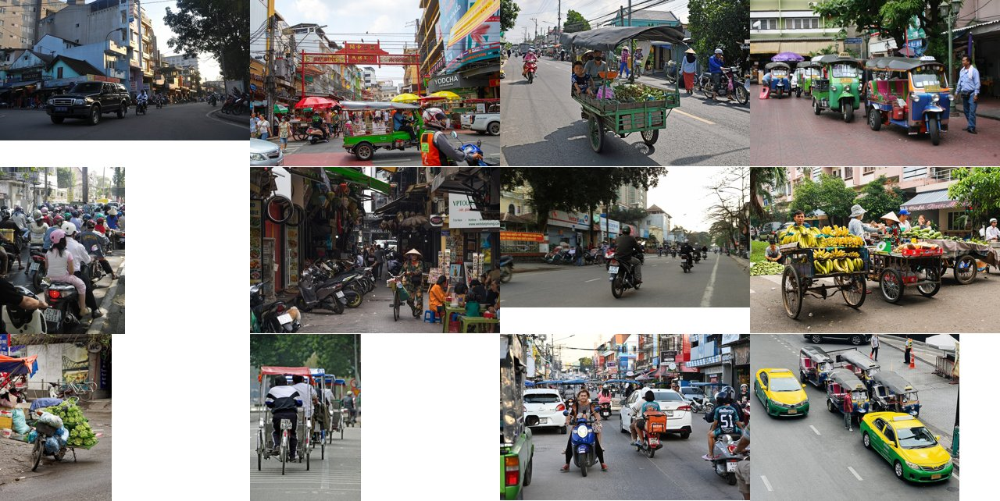
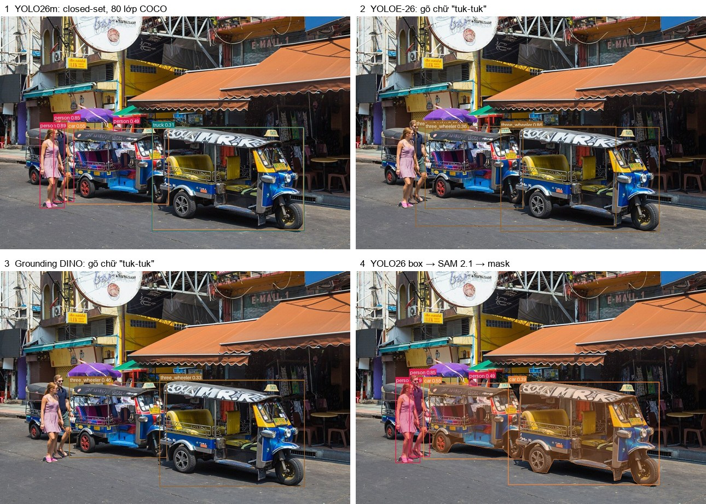
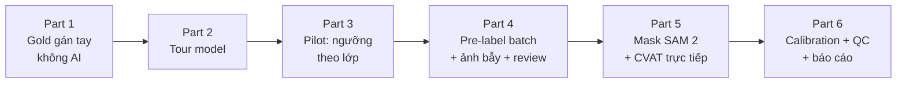

# Day 08 Lab — AI hỗ trợ gán nhãn: Pre-label, Review, Calibration

**Cá nhân · 7–10 giờ (chia 3 buổi) · 36 ảnh đường phố châu Á · detection + segmentation · CVAT**

Hôm nay **máy gán sẵn, người sửa**. Bạn sẽ cài và chạy các công cụ pre-label **từ đơn giản đến phức tạp**
(YOLO26 → SAM 2.1 → YOLOE → Grounding DINO / OWLv2 → SAM 3), đưa kết quả vào CVAT, **review có quy trình**,
rồi **calibration** lại nhãn và guideline, và đo xem máy giúp được bao nhiêu (và làm bạn lười đến mức nào).

*Có gì lạ trong ảnh? Tuk-tuk, xích lô, xe ba gác: model COCO có sẵn gọi chúng là `car` / `truck`. Đó là lý do cần open-vocabulary.*

## Quy trình

Trọng tâm: **máy chỉ đề xuất; bạn là chốt chặn chất lượng** và phải **đo** được nhãn của mình tốt đến đâu (không phải tin vì "trông đúng").

## Bắt đầu

1. **Fork** repo này thành repo **public** của bạn (đặt tên theo [SUBMISSION.md](SUBMISSION.md)), `git clone`.
2. Đọc **[GUIDE.md](GUIDE.md)** (từng Part, lệnh chạy) và **[RULES.md](RULES.md)**.
3. Cài môi trường theo **[docs/SETUP.md](docs/SETUP.md)** (Python 3.10–3.12; không bắt buộc GPU).

> **Khi nộp:** đổi dòng tiêu đề này thành `# Day 08 Lab — <MSHV> - <Họ và tên>`. Xem [SUBMISSION.md](SUBMISSION.md).

## Bạn sẽ học được gì

- Chọn đúng **họ model** cho việc: click (SAM) · gõ chữ (YOLOE, Grounding DINO, OWLv2, SAM 3) · danh mục cố định (YOLO26).
- Đưa nhãn máy vào CVAT hai cách: **offline import** và **trực tiếp** (AI Tools, `cvat-cli`).
- Duyệt bằng **checklist bốn bước**, nhận ra **thiên kiến tự động hóa** bằng **ảnh bẫy** của chính bạn.
- Đo **AI error profile** (accepted / edited / deleted / added), precision / recall của máy so với **gold gán tay**, và tỉ lệ bắt **ảnh bẫy** (đo chính bạn).
- **Calibration** ở bốn tầng: ngưỡng theo lớp, guideline, nhất quán của chính bạn, QC và Release / Hold / Rework.

## Tài liệu

| Bạn cần | Xem |
|---|---|
| Các Part và lệnh chạy | [GUIDE.md](GUIDE.md) |
| Mốc tiến độ | [CHECKPOINTS.md](CHECKPOINTS.md) |
| Quy tắc làm bài | [RULES.md](RULES.md) |
| Chấm điểm (100 điểm) | [RUBRIC.md](RUBRIC.md) |
| Sản phẩm phải nộp, tên repo, checklist | [SUBMISSION.md](SUBMISSION.md) |
| Cài đặt môi trường, tải model | [docs/SETUP.md](docs/SETUP.md) |
| Tour các model (YOLO26, SAM 2, YOLOE, Grounding DINO, OWLv2, SAM 3) | [docs/MODELS.md](docs/MODELS.md) |
| Dùng pre-label với CVAT (import, AI Tools, cvat-cli) | [docs/CVAT_AI.md](docs/CVAT_AI.md) |
| Quy trình review, ảnh bẫy | [docs/REVIEW_CHECKLIST.md](docs/REVIEW_CHECKLIST.md) |
| Calibration và QC, cách đọc số đo | [docs/CALIBRATION_QC.md](docs/CALIBRATION_QC.md) |
| Label contract (guideline v1.0) và khung v1.1 | [guideline/](guideline/) |
| Các script | [scripts/README.md](scripts/README.md) |
| Nguồn và giấy phép ảnh | [data/README.md](data/README.md), [data/ATTRIBUTION.csv](data/ATTRIBUTION.csv) |
| Thông tin và kết quả tóm tắt của bạn | [STUDENT.md](STUDENT.md) |
