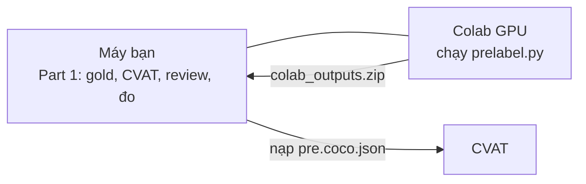

# Chạy model trên Google Colab (cho máy yếu)

**Khi nào dùng:** laptop không có GPU hoặc chạy model quá chậm / thiếu RAM. Colab cho **GPU T4 miễn phí** để chạy `prelabel.py`.
**Không thay thế được:** CVAT, review, các script đo, git. Những việc đó vẫn làm trên máy bạn.

> Notebook: [notebooks/day08_colab.ipynb](../notebooks/day08_colab.ipynb). *(Notebook được viết theo đúng lệnh của lab nhưng chưa được chạy thử trên Colab thật: nếu một ô lỗi, đọc lỗi, ghi vào `REPORT.md` và báo giảng viên.)*

## Luồng làm việc

| Part | Làm ở đâu |
|---|---|
| 0 Cài đặt | máy bạn: venv + `check_env.py` (không cần model nặng); Colab: chạy ô 0–2 của notebook |
| 1 Gold gán tay | **máy bạn + CVAT** (không cần model) |
| 2 Tour model | **Colab** (ô 3), xem `viz/` ngay trong notebook; ghi `model_log.csv` ở máy bạn |
| 3 Pilot | Colab (ô 4–5) tạo `merged_pilot/pre.coco.json` → tải về → CVAT; **`threshold_sweep.py` chạy ở máy bạn** |
| 4 Batch + bẫy | Colab (ô 6) gộp; `inject_traps.py` nên chạy ở máy bạn (hạt giống + đáp án nằm trong repo bạn) |
| 5 Mask | Colab (ô 7): chọn `SAM = ...` (SAM 1 / 2.1) hoặc SAM 3 qua Secrets |
| 6 Calibration, QC | máy bạn (script nhẹ, không cần GPU) |

## Từng bước

1. Bấm nút **Mở trong Colab** ở trên (cần tài khoản Google). Menu **Runtime → Change runtime type → T4 GPU → Save**.
2. Chạy lần lượt các ô từ trên xuống (`Shift+Enter`). Ô 0 sao chép mã nguồn lab; có thể đổi `REPO_URL` thành repo fork **public** của bạn.
3. Ô 2 tải model. SAM là **bắt buộc**: `core` đã có SAM 2.1; muốn SAM 1 bỏ comment dòng `--set sam1`.
4. Ô 8 gói kết quả thành `colab_outputs.zip` và tải về. **Giải nén vào thư mục repo trên máy bạn**, giữ nguyên đường dẫn (`work/prelabel/...`, `submission/prelabel/...`).
5. Tiếp tục theo [CVAT_AI.md](CVAT_AI.md) mục 3 (nạp vào CVAT) và `GUIDE.md`.

## Lưu ý quan trọng

- **Phiên Colab tạm thời**: hết phiên (không dùng ~vài chục phút, hoặc tối đa ~12 giờ) là mất mọi file. **Tải `colab_outputs.zip` sau mỗi Part**, đừng để dồn.
- **GPU miễn phí không bảo đảm**: có lúc hết hạn mức. Khi đó chờ vài giờ hoặc chuyển sang CPU với `--size n` (xem [SETUP.md](SETUP.md) mục 5).
- **SAM 3 trên Colab**: lưu `HF_TOKEN` vào **Colab Secrets** (biểu tượng chìa khoá), bật *Notebook access*. **Không dán token vào ô code** và không commit.
- **Bẫy và gold**: nếu chạy `inject_traps.py` trên Colab, tải **cả** `pre_traps.coco.json` và `traps_key.json` về `submission/prelabel/`, và **đừng mở** file đáp án trước khi duyệt xong (quy tắc [RULES.md](../RULES.md)).
- **Số liệu thời gian**: `sec_per_img` từ Colab là thời gian trên GPU Colab; ghi chú `device = cuda (Colab T4)` trong `model_log.csv` để người chấm hiểu.
- Ảnh bộ dữ liệu nằm trong repo nên Colab không cần tải riêng.
- Không upload ảnh ngoài bộ dữ liệu của lab lên Colab / Drive (xem mục dữ liệu trong RULES.md).
