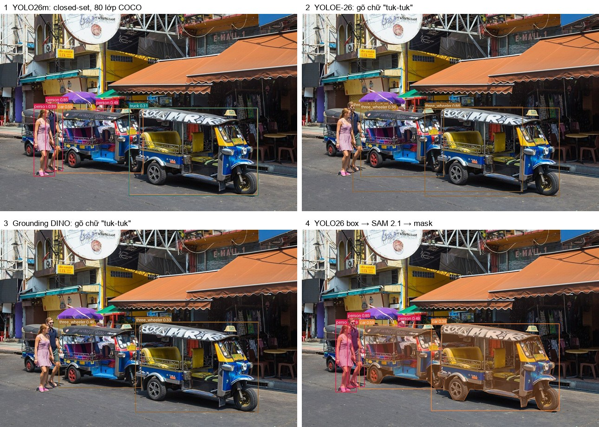
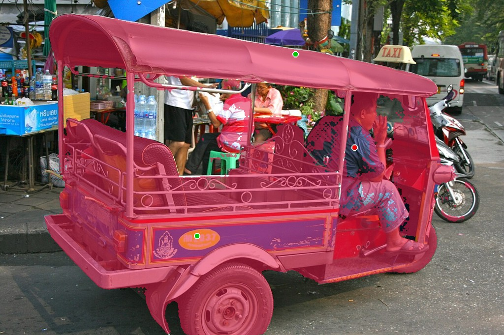

# Tour các model pre-label (Part 2)

Đi **từ đơn giản đến phức tạp**. Mỗi mục: model là gì → lệnh chạy → **nhìn gì** → câu hỏi để ghi vào `submission/model_log.csv`.
Mọi lệnh chạy ở thư mục gốc repo, venv đã kích hoạt ([SETUP.md](SETUP.md)). Ảnh kết quả ở `work/prelabel/<tên>/viz/`.



*Cùng ảnh `img_017`: (1) YOLO26 gọi tuk-tuk là `car`/`truck`, (2) YOLOE gõ chữ tìm được tuk-tuk nhưng box lỏng, (3) Grounding DINO tương tự, (4) SAM 2.1 biến box thành mask (nhưng mask chỉ đúng khi box đúng).*

## Bản đồ nhanh

| # | Model | Đầu vào | Đầu ra | Dùng khi | Điểm yếu cần kiểm |
|---|---|---|---|---|---|
| A | **YOLO26** | ảnh | box + 1 trong 80 lớp COCO | lớp đã có trong COCO, số lượng lớn | không biết lớp mới (tuk-tuk → car/truck), vật nhỏ ở xa |
| B | **SAM 2.1** | ảnh + click / box | mask | cần đường bao sát | mask chỉ tốt khi prompt tốt; một click mơ hồ (vật hay bộ phận?) |
| C | **YOLOE-26** (open-vocab, real-time) | ảnh + chữ | box + mask | lớp mới, cần nhanh | gọi nhầm lớp, box lỏng, chữ khác nhau cho kết quả khác nhau |
| D | **Grounding DINO**, **OWLv2** (open-vocab, nặng hơn) | ảnh + chữ | box | cần thử model khác để so sánh | chậm hơn; ngưỡng text/box khác nhau; nhận nhầm khái niệm |
| E | **SAM 3** (concept prompting) | ảnh + chữ | **mọi instance + mask** | muốn mask hàng loạt từ chữ | gated; yếu với khái niệm hiếm / bị che |
| F | Ghép lại thành **recipe** | | | cuối Part 2 | |

Quy tắc ghi `model_log.csv` (mỗi lần chạy một dòng): `run_id, part, model, params, split, n_boxes, sec_per_img, what_went_right, what_went_wrong, decision`.
Mỗi lần chạy `prelabel.py` tự ghi một dòng vào `work/runs.csv` (không commit) **có đúng các cột đó** (`run_id`, `params`, `part` để trống): copy dòng sang `model_log.csv`, điền `part` và 3 cột nhận xét **bằng mắt nhìn ảnh**. (`sam2_points.py` và các lần thử tay không tự ghi: tự thêm dòng.) Số liệu không có nhận xét không được điểm.

> **Luôn đọc dòng cuối của lệnh**: `Tên thô KHÔNG có trong ánh xạ ...` cho biết những lớp COCO (bottle, umbrella...) bị bỏ vì không có trong taxonomy.
> Đó chính là hộp thoại *Labels matching* của CVAT: ánh xạ thiếu = mất box im lặng.

---

## A. YOLO26 — detector đóng (closed-set)

**Là gì.** Detector thời gian thực của Ultralytics, huấn luyện sẵn trên 80 lớp COCO. Chỉ nói được những lớp trong danh sách đó.
Cỡ model: `n` (nhỏ, nhanh) … `x` (lớn, chậm). Lab dùng `m`.

```bash
# 1) ngưỡng thấp (0.05): xem máy "nghĩ" ra những gì; nhiều box thừa
python scripts/prelabel.py --model yolo26 --size m --split pilot --conf 0.05 --out work/prelabel/y26_pilot_c005
# 2) ngưỡng thường dùng (0.25)
python scripts/prelabel.py --model yolo26 --size m --split pilot --conf 0.25 --out work/prelabel/y26_pilot_c025
# 3) ngưỡng cao (0.5): sạch hơn nhưng sót
python scripts/prelabel.py --model yolo26 --size m --split pilot --conf 0.5  --out work/prelabel/y26_pilot_c050
```

**Nhìn gì.** So `viz/` của ba lần chạy trên `img_011` và `img_016`:
- Số box đổi thế nào theo ngưỡng (xem dòng "Số box theo lớp")? Ngưỡng nào bạn bắt đầu thấy xe bị bỏ sót? Ngưỡng nào còn nhiều box thừa?
- **Tuk-tuk / ba gác** được gọi là gì? (gợi ý: thường `car` hoặc `truck`). Đây là lý do cần model open-vocab (mục C).
- Người ngồi trên xe máy: có box `person` riêng không? Có box `motorbike` riêng không?
- Có lớp nào bị bỏ vì không ánh xạ không (`banana`, `umbrella`...)? Bỏ như vậy có đúng với taxonomy không?

**Ghi `model_log`:** ba dòng (ba ngưỡng), `what_went_wrong` ghi lỗi **cụ thể** (ảnh, vật), không ghi "kém".

### A2. YOLO26-seg — mask từ chính detector

```bash
python scripts/prelabel.py --model yolo26 --size m --segmenter native --images img_004.jpg img_013.jpg --out work/prelabel/y26seg_demo
```

Mở `viz/`: mask của YOLO26-seg thường **thô** (đa giác thấp độ phân giải). So với SAM 2.1 ở mục B2.

---

## B. SAM 2.1 — Segment Anything: từ prompt ra mask

**Là gì.** Model "phân đoạn mọi thứ" của Meta. Bạn đưa **prompt hình học** (click dương / âm, hoặc box) và nó trả mask. Không biết tên lớp.
Trong CVAT đây là công cụ **Interactor** (click trái = thêm, click phải = bớt).

### B1. Prompt bằng click (mô phỏng Interactor)

```bash
# một click vào huy hiệu vàng trên thân xe: mask rất nhỏ (chỉ cái huy hiệu)
python scripts/sam2_points.py --image img_013.jpg --pos 400,480 --out work/sam2_a
# thêm click lên mui xe: mask phủ cả xe
python scripts/sam2_points.py --image img_013.jpg --pos 400,480 --pos 600,110 --out work/sam2_b
# thêm click ÂM lên người lái, thử 1 rồi 2-3 click
python scripts/sam2_points.py --image img_013.jpg --pos 400,480 --pos 600,110 --neg 720,300 --out work/sam2_c
```



*Chấm xanh = click dương, chấm đỏ = click âm. Mask phủ cả xe **kèm người lái**.*

**Nhìn gì.**
- Một click cho mask là **bộ phận, vật, hay cả nhóm**? Slide gọi đó là "một click, ba mask hợp lệ": **label contract quyết định, không phải model**.
- Guideline v1.0 nói người là `person` riêng, xe là `three_wheeler` riêng: mask của xe có gồm người lái không? Cần bao nhiêu click âm để loại?
- Số polygon của mask (dòng in ra): vật rời rạc (do bị che) cho nhiều polygon. Guideline nói gì?

### B2. Box → mask (kiểu "detector rồi segmenter")

```bash
python scripts/prelabel.py --model yolo26 --size m --classes person,motorbike,car --images img_004.jpg img_013.jpg \
    --conf 0.3 --segmenter sam2 --out work/prelabel/y26_sam2
```

**Nhìn gì.** Mask đúng khi box đúng. Box sai (ví dụ `car` bao cả tuk-tuk) thì mask tô **cả tuk-tuk** và vẫn mang nhãn sai: **sai lớp không phải do mask**.
So biên mask của SAM 2.1 với mask của YOLO26-seg (A2): cái nào bám sát hơn? Cái nào sót / thừa phần nào?
Lỗi lan truyền: nếu box thừa (không có vật) thì mask là gì? (gợi ý: thử một ảnh có `chair` hoặc `umbrella` bị gán nhầm.)

---

## C. YOLOE-26 — open-vocabulary, gõ chữ ra box + mask

**Là gì.** Biến thể YOLO nhận **danh sách chữ** thay vì 80 lớp cố định ("zero-shot": chưa huấn luyện riêng cho lớp đó), vẫn chạy rất nhanh.
Lệnh dùng `--prompts 'cụm chữ=lớp'` để nối chữ với lớp trong taxonomy. `--classes three_wheeler` để chỉ giữ lớp đó.

```bash
# prompt mặc định lấy từ taxonomy.json: tuk-tuk, cyclo, cargo tricycle -> three_wheeler
python scripts/prelabel.py --model yoloe --classes three_wheeler --split pilot --conf 0.25 --out work/prelabel/yoloe_pilot
# thử CHỮ KHÁC: một khái niệm một prompt
python scripts/prelabel.py --model yoloe --prompts "three-wheeled vehicle=three_wheeler" --classes three_wheeler \
    --split pilot --conf 0.25 --out work/prelabel/yoloe_pilot_v2
# prompt bẫy (hard negative): thêm "motorbike" để thấy nó có giành lấy xe ba bánh không
python scripts/prelabel.py --model yoloe --prompts "tuk-tuk=three_wheeler,motorbike=motorbike,car=car" \
    --split pilot --conf 0.25 --out work/prelabel/yoloe_pilot_v3
```

**Nhìn gì.**
- Tuk-tuk, xích lô, ba gác: model tìm được loại nào, bỏ sót loại nào? (Xích lô và xe ba gác thường khó hơn tuk-tuk.)
- Đổi chữ prompt: số box và độ chính xác đổi thế nào? Có chữ nào cho kết quả tốt hơn rõ rệt?
- Prompt "motorbike=motorbike": box xe ba bánh có bị đổi nhãn thành motorbike không?
- Box có **lỏng** (rộng hơn vật) không? Box có phủ cả người ngồi / vật phía sau không?

**Cạm bẫy (slide, 4 luật viết prompt):** một khái niệm một prompt; attribute ≠ vật; viết rõ hard negative; ngưỡng **theo từng lớp**.

---

## D. Grounding DINO và OWLv2 — open-vocab "nặng" (so sánh)

**Là gì.** Hai model gõ-chữ-ra-box khác họ với YOLOE: Grounding DINO (text-grounded, Transformer, `IDEA-Research/grounding-dino-tiny`) và OWLv2 (`google/owlv2-base-patch16-ensemble`). Chậm hơn YOLOE ~3–10×.

```bash
python scripts/prelabel.py --model gdino --classes three_wheeler --split pilot --conf 0.3 --out work/prelabel/gdino_pilot
python scripts/prelabel.py --model owlv2 --classes three_wheeler --split pilot --conf 0.2 --out work/prelabel/owlv2_pilot
```

> Grounding DINO có thêm `--text-thr` (ngưỡng text, mặc định 0.25). OWLv2 trên Mac tự chạy CPU, chậm hơn nhưng ổn.
> Ngưỡng điểm của ba model **không so trực tiếp được** với nhau: 0.3 ở model này ≠ 0.3 ở model kia.

**Nhìn gì.** Lập bảng nhỏ cho `img_002`, `img_011`, `img_016`... (ảnh pilot có xe ba bánh): số tuk-tuk đúng (bạn tự đếm), YOLOE tìm được bao nhiêu, gdino, owlv2; ai có box thừa; ai nhanh nhất (`sec_per_img`).
**Không có model "thắng tuyệt đối"**: chọn model theo lớp và theo ngưỡng của chính **dữ liệu của bạn** (pilot).

---

## E. SAM 3 — concept prompting: gõ chữ, ra mọi instance + mask (tuỳ chọn)

**Là gì.** SAM 3 (Meta, 2025) nhận **cụm danh từ** và trả mask cho **mọi** vật khớp, không cần click. Yếu ở khái niệm hiếm, vật bị che (slide: cgF1 65.0 so với 74.2 của người).
Model gated: xin quyền trước ([SETUP.md](SETUP.md) mục 4).

```bash
python scripts/download_models.py --set sam3
python scripts/prelabel.py --model sam3 --classes three_wheeler --images img_004.jpg img_013.jpg --conf 0.4 --out work/prelabel/sam3_demo
```

> Đường chạy SAM 3 trong repo này chưa được kiểm chứng trên máy giảng viên (cần quyền truy cập). Nếu API của `transformers` khác bản ghi trong script,
> báo lỗi đầy đủ cho giảng viên thay vì tự sửa; ghi `decision = skipped` vào `model_log.csv`.

**Nhìn gì (nếu chạy được).** Mask có tách riêng từng tuk-tuk khi xếp sát nhau (img_004)? Có gom cả người lái vào xe không? So với B2 (box → SAM 2.1): bớt được bước nào? Còn lỗi nào?

---

## F. Ghép thành recipe (cuối Part 2)

Không model đơn lẻ nào đủ: **YOLO26** giỏi 6 lớp COCO nhưng mù tuk-tuk; **YOLOE** biết tuk-tuk nhưng kém 6 lớp kia; **SAM 2.1** cho mask từ box.
Recipe đề xuất (bạn **được** đổi nếu thí nghiệm của bạn cho kết quả khác; ghi lý do):

```bash
# 1) chạy model ở ngưỡng THẤP một lần trên MỌI ảnh (GPU/MPS ~15 giây; CPU vài phút)
python scripts/prelabel.py --model yolo26 --size m --split all --conf 0.05 --out work/prelabel/y26_all --no-viz
python scripts/prelabel.py --model yoloe --classes three_wheeler --split all --conf 0.05 --out work/prelabel/yoloe_all --no-viz
# 2) gộp, áp ngưỡng và loại trùng (three_wheeler của YOLOE thắng car/truck của YOLO26 khi chồng nhau, IoU >= 0.6)
python scripts/merge_prelabels.py work/prelabel/yoloe_all/pre.coco.json work/prelabel/y26_all/pre.coco.json \
    --conf 0.1 --iou 0.6 --split pilot --out work/prelabel/merged_pilot/pre.coco.json
```

Ngưỡng `--conf 0.1` ở đây là **tạm, để dựng GT pilot**: Part 3 sẽ chọn ngưỡng theo lớp bằng dữ liệu (`threshold_sweep.py`). Ghi recipe cuối vào `submission/recipe.md` (mẫu có sẵn).

### Câu hỏi tổng kết Part 2 (ghi vào REPORT.md, phần 1)

1. Với từng lớp của taxonomy, model nào bạn chọn và vì sao (dẫn dòng `model_log`)?
2. Lỗi nào của máy **không thể sửa bằng đổi ngưỡng** (gợi ý: sai lớp tuk-tuk)? Sửa bằng cách nào (đổi model / ánh xạ / sửa tay)?
3. Slide nói *"điểm tin cậy không bảo đảm nhãn đúng"*: bạn đã thấy ví dụ nào trong ảnh pilot (box điểm cao mà sai, hoặc điểm thấp mà đúng)?
